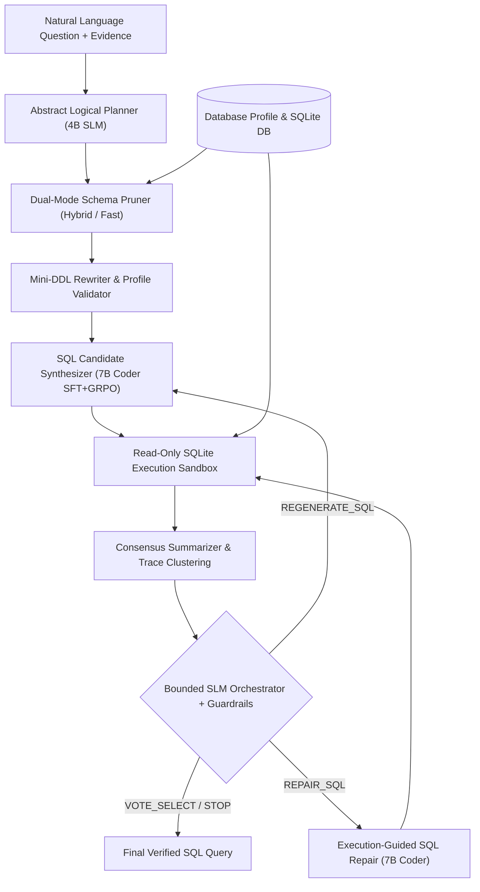

# Text2SQL-Agent: Stateful Execution-Guided Text-to-SQL Framework

[](https://www.python.org/downloads/)
[](https://pytorch.org/)
[](https://github.com/vllm-project/vllm)
[](https://github.com/astral-sh/ruff)
[](LICENSE)

**Text2SQL-Agent** is a production-grade, stateful, execution-guided single-agent Text-to-SQL framework designed for reliable on-premise deployment. Rather than relying on unconstrained multi-agent conversations, the system operates as a **single unified agent** driving a bounded state machine and routing specialized subtasks across **heterogeneous language models**:

- **Dense Schema Representation**: `BAAI/bge-small-en-v1.5` for semantic table and column linking.
- **Logical Planning & State Orchestration**: 4B Small Language Model (`Qwen/Qwen3-4B-Instruct-2507`) for schema-agnostic query decomposition, Mini-DDL compression, and execution-guided transition routing.
- **SQL Synthesis & Self-Repair**: 7B Code LLM (`Qwen/Qwen2.5-Coder-7B-Instruct` post-trained via Cold-Start SFT and Execution-Guided GRPO) for schema-constrained candidate generation and error-driven query repair.

Evaluated on the **BIRD Benchmark**, the framework achieves **64.27% Execution Accuracy (EX)** and **68.67% Valid Efficiency Score (VES)**.

---

## Table of Contents

1. [System Architecture](#1-system-architecture)
2. [Core Capabilities](#2-core-capabilities)
3. [Model Zoo & Benchmark Performance](#3-model-zoo--benchmark-performance)
4. [Repository Structure](#4-repository-structure)
5. [Installation & Environment Setup](#5-installation--environment-setup)
6. [Usage Guide](#6-usage-guide)
7. [Two-Stage Post-Training (SFT + GRPO)](#7-two-stage-post-training-sft--grpo)
8. [Testing & Code Quality](#8-testing--code-quality)
9. [License](#9-license)

---

## 1. System Architecture



---

## 2. Core Capabilities

### Context-Aware Schema Linking (`src/schema_linking/`)
- **Abstract Logical Planner**: Decomposes complex natural language questions into schema-agnostic reasoning steps prior to schema exposure, reducing distractors from large database schemas.
- **Dual-Mode Schema Pruner**:
  - **Hybrid Mode**: Combines `BM25Okapi` ($0.6$) with dense `BAAI/bge-small-en-v1.5` cosine similarity ($0.4$), dynamic score thresholding ($\tau = 0.15$), SQLite `LIKE` physical literal probing, and **Steiner Tree approximation** (`networkx`) over foreign key graphs to guarantee valid join connectivity.
  - **Fast Mode**: Low-latency in-memory lexical scoring with rule-based boosts (`+8.0` backtick identifier match, `+4.0` column mention, `+2.0` table mention, `+10.0` sample value match) and **BFS shortest-path** foreign key closure.
- **Mini-DDL Rewriter & Validator**: Compresses linked tables and columns into minimal `CREATE TABLE` statements annotated with sample values and descriptions. Validates generated DDL against physical database metadata and falls back to deterministic algorithmic DDL if hallucinated identifiers are detected.

### Stateful Orchestration & Read-Only Sandbox (`src/sandbox/`, `src/agent/`)
- **Zero-Side-Effect SQLite Sandbox**: Enforces read-only execution via SQLite URI `file:{db_path}?mode=ro`, regex-based DDL/DML blocking (`INSERT`, `UPDATE`, `DELETE`, `DROP`, `ALTER`, `PRAGMA`, `ATTACH`), and C-level query timeout interrupts (`conn.set_progress_handler`).
- **Consensus Summarizer**: Normalizes result rows into order-invariant canonical tuples, groups candidate queries into equivalence clusters, and isolates syntax/timeout/runtime error traces.
- **Bounded SLM Orchestrator**: Inspects aggregated execution feedback to transition deterministically across states (`VOTE_SELECT`, `REPAIR_SQL`, `REGENERATE_SQL`, `STOP_WITH_BEST`, `STOP_WITH_FALLBACK`), strictly enforced by runtime transition guardrails.

### Execution-Guided Post-Training (`src/training/`)
- **Stage 1 (Cold-Start SFT)**: QLoRA fine-tuning (`r=32`, `lora_alpha=64`) enforcing structured `<think>...</think><answer>...</answer>` reasoning traces.
- **Stage 2 (GRPO Reinforcement Learning)**: Group Relative Policy Optimization guided by composite rule-based and execution rewards:
  - **Format Reward**: Validates adherence to `<think>` and `<answer>` XML tags.
  - **Execution Reward**: Penalizes syntax errors, timeouts, and runtime exceptions inside the read-only SQLite sandbox.
  - **Result Equivalence Reward**: Evaluates canonical result-set equivalence against ground-truth Gold SQL.

---

## 3. Model Zoo & Benchmark Performance

| Component | Model Identifier | Parameters | Role |
| :--- | :--- | :---: | :--- |
| **Dense Embedder** | `BAAI/bge-small-en-v1.5` | 33M | Semantic table/column retrieval |
| **Planner & Orchestrator** | `Qwen/Qwen3-4B-Instruct-2507` | 4B | Logical planning, Mini-DDL rewrite, state routing |
| **SQL Synthesizer** | `NguyenCX/Qwen2.5_coder_7B_instruct_GRPO_BIRD` | 7B | Candidate SQL synthesis & error-driven repair |

| Benchmark | Split | Execution Accuracy (EX) | Valid Efficiency Score (VES) |
| :--- | :---: | :---: | :---: |
| **BIRD-SQL** | Dev | **64.27%** | **68.67%** |

---

## 4. Repository Structure

```text
text2sql-agent/
├── configs/
│   ├── agent_config.yaml          # Schema pruning parameters & state machine limits
│   ├── model_config.yaml          # vLLM, quantized HF, and embedding configurations
│   └── train_config.yaml          # SFT & GRPO training hyperparameters
├── data/
│   └── sample_databases/          # Local SQLite databases (.sqlite)
├── db_info/                       # Pre-extracted database schema profiles & sample values
├── demo/
│   └── app.py                     # Interactive Gradio web interface
├── docker/
│   ├── Dockerfile                 # CUDA 12.1 production container image
│   └── docker-compose.yml         # GPU service orchestration
├── scripts/
│   ├── eval_srr.py                # Schema Retention Rate (SRR) evaluation CLI
│   └── run_pipeline.py            # End-to-end Text-to-SQL inference CLI
├── src/
│   ├── agent/
│   │   ├── orchestrator.py        # SQLOrchestrator, runtime guardrails & candidate voter
│   │   └── state.py               # AgentState & CandidateTrace data structures
│   ├── models/
│   │   ├── engine.py              # VLLMRunner, HFQuantizedRunner & HuggingFaceEmbedder
│   │   └── prompts.py             # System & user prompt templates across pipeline stages
│   ├── sandbox/
│   │   ├── executor.py            # Read-only SQLite sandbox & physical literal prober
│   │   └── summarizer.py          # Result canonicalization & equivalence clustering
│   ├── schema_linking/
│   │   ├── ddl_rewriter.py        # Algorithmic & SLM Mini-DDL generation and validation
│   │   ├── planner.py             # Abstract schema-agnostic LogicalPlanner
│   │   ├── profiler.py            # DatabaseProfile loader & in-memory sample matcher
│   │   └── pruner.py              # HybridSchemaPruner (Steiner Tree) & FastSchemaPruner (BFS)
│   └── training/
│       ├── rewards.py             # Format, sandbox execution & Gold match GRPO rewards
│       ├── sft_dataset.py         # SFT reasoning trace & SQL validator
│       ├── train_grpo.py          # Stage 2 GRPO reinforcement learning entrypoint
│       └── train_sft.py           # Stage 1 QLoRA SFT training entrypoint
├── tests/
│   └── test_pipeline.py           # Unit & integration test suite
└── pyproject.toml                 # Project metadata & uv dependency lock configuration
```

---

## 5. Installation & Environment Setup

### Prerequisites
- **OS**: Linux (Ubuntu 20.04+ recommended)
- **Python**: `>=3.10, <3.12`
- **GPU**: NVIDIA GPU with CUDA 12.1+ (`>=16GB` VRAM for vLLM; `>=8GB` VRAM for 4-bit quantized mode)
- **Package Manager**: [`uv`](https://docs.astral.sh/uv/)

### Local Installation via `uv`

```bash
# Clone the repository
git clone https://github.com/XuanNguyen-UET/text2sql-agent.git
cd text2sql-agent

# Sync core inference dependencies
uv sync

# Sync with training (TRL, PEFT, BitsAndBytes) and development (Pytest, Ruff) extras
uv sync --extra train --extra dev
```

### Docker Deployment

```bash
# Build and launch the GPU-accelerated Gradio service on port 7860
export HF_TOKEN="your_huggingface_token"
docker compose -f docker/docker-compose.yml up --build -d
```

---

## 6. Usage Guide

### 6.1. End-to-End CLI Inference

Run the pipeline on a target SQLite database using high-throughput `vllm` or low-VRAM `transformers_4bit`:

```bash
# High-throughput vLLM execution
uv run python scripts/run_pipeline.py \
  --db_id financial \
  --question "What is the average loan amount for accounts opened in 1995?" \
  --evidence "accounts opened in 1995 refers to date LIKE '1995%'" \
  --profiles_path db_info/dev_profiles_explicit.json \
  --db_dir data/sample_databases \
  --backend vllm \
  --output_json outputs/predict_result.json

# Low-VRAM 4-bit NF4 quantized execution
uv run python scripts/run_pipeline.py \
  --db_id financial \
  --question "List the top 5 districts with the highest average salary." \
  --backend transformers_4bit \
  --output_json outputs/predict_result.json
```

### 6.2. Interactive Web UI (Gradio)

Launch the interactive web interface to inspect intermediate outputs (Logical Plan, Pruned Mini-DDL, Execution Traces, and Final SQL):

```bash
uv run python demo/app.py
```
Once launched, navigate to `http://localhost:7860` in your browser.

### 6.3. Schema Retention Rate (SRR) Evaluation

Evaluate how effectively the schema pruner retains tables and columns required by ground-truth Gold SQL queries:

```bash
uv run python scripts/eval_srr.py \
  --gold_file data/dev.json \
  --pruned_file outputs/pruned_schemas.json
```

---

## 7. Two-Stage Post-Training (SFT + GRPO)

Training configurations and hyperparameters are managed in [`configs/train_config.yaml`](configs/train_config.yaml).

### Stage 1: Cold-Start Supervised Fine-Tuning (SFT)
Trains the base `Qwen/Qwen2.5-Coder-7B-Instruct` model with QLoRA adapters on validated `<think>...</think><answer>...</answer>` reasoning traces:

```bash
uv run python -m src.training.train_sft \
  --config configs/train_config.yaml \
  --output_dir checkpoints/sft_adapter
```

### Stage 2: Execution-Guided GRPO Reinforcement Learning
Optimizes the policy using live SQLite sandbox execution rewards and canonical result equivalence:

```bash
uv run python -m src.training.train_grpo \
  --config configs/train_config.yaml \
  --output_dir checkpoints/grpo_final
```

---

## 8. Testing & Code Quality

This repository enforces strict linting, formatting, and unit testing standards:

```bash
# Execute the unit and sandbox safety test suite
uv run pytest tests/ -v

# Run Ruff linter and auto-fix issues
uv run ruff check . --fix

# Format codebase according to project standards
uv run ruff format .
```

---

## 9. License

This project is licensed under the **MIT License**. See the [LICENSE](LICENSE) file for details.
